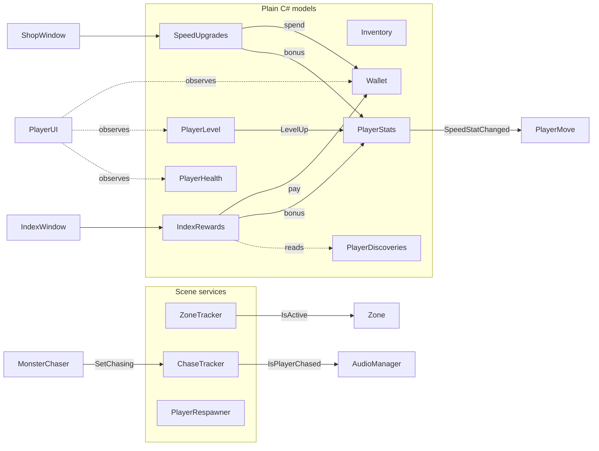

# 🐱 Thief Cat

**Explore. Collect. Cook. Grow! 🍎**

A 3D casual adventure / restaurant sim in Unity. The cat steals ingredients across the map, runs from the
monsters that guard them, cooks dishes in a food truck and sells them to passing clients. This README covers
the game loop and, mostly, how the code is put together.

---

## 🎮 Gameplay loop

```
 Explore zone ──► Pick up item ──► Guard monster chases you ──► Reach the truck (hub)
      ▲                                                               │
      │                                                               ▼
 Spend money on    ◄── Clients buy dishes  ◄── Dish goes on  ◄── Cook a recipe
 speed / rewards       from the showcase       the showcase       from the storage
```

- 🧭 **Explore.** The map is split into zones (e.g. the forest). Only the zone near the player is simulated.
- 🍒 **Collect.** Item capsules (`Lvl N`) lie on the ground. The inventory holds one item of each type.
- 👹 **Escape.** Picking up an item wakes its guard. Monster hits cost health, and dying drops every carried item.
- 🍳 **Cook.** Items unloaded at the truck go to its storage. A recipe takes them and, after its cook time, puts the dish on the showcase.
- 💰 **Sell.** A client buys a dish if the dish's *interest* is at least the client's own. The player is paid when the client takes it.
- 📈 **Grow.** Experience raises the level and speed stat. Money buys speed upgrades. Completing index categories and contracts gives rewards.

---

## 🛠️ Tech stack

| | |
|---|---|
| **Engine** | Unity **6000.3.8f1** (Unity 6), URP 17.3 |
| **DI** | [Zenject (Extenject)](https://github.com/modesttree/Zenject), in `Assets/Plugins/Zenject` |
| **Reactive** | [R3](https://github.com/Cysharp/R3) 1.3.1 via NuGetForUnity (`Assets/packages.config`) |
| **Tweening** | DOTween (Demigiant), in `Assets/Plugins/Demigiant` |
| **Input** | Input System 1.18 (`Assets/InputSystem_Actions.inputactions`) |
| **Camera** | Cinemachine 3.1 |
| **Navigation** | AI Navigation 2.0 |
| **UI** | uGUI + TextMesh Pro |

Platform: Windows (PC). Single scene: `Assets/Scenes/SampleScene.unity`.

---

## 🏗️ Architecture

### Composition root

All scene-wide services are bound in a single installer, [`GameInstaller`](Assets/Scripts/Infrastructure/GameInstaller.cs),
on the `SceneContext`. There are no singletons, `FindObjectOfType` or `GameObject.Find` calls in the game code.
Scene objects receive their dependencies through `[Inject] Construct(...)` methods, which Zenject calls in
`SceneContext.Awake`, before any other `Awake`. Objects created at runtime (for example, guard monsters) are
instantiated through `IInstantiator`, so they are injected too.

```csharp
// Player state: plain C# models, one of each per scene
Container.Bind<PlayerHealth>().AsSingle().WithArguments(_playerSettings.MaxHealth);
Container.Bind<Inventory>().AsSingle().WithArguments(_playerSettings.MaxItems);
Container.Bind<Wallet>().AsSingle();
Container.Bind<PlayerLevel>().AsSingle().WithArguments(_playerSettings.LevelCurve);
Container.BindInterfacesAndSelfTo<PlayerStats>().AsSingle();

// Scene services with a lifecycle (ITickable / IInitializable / IDisposable)
Container.BindInterfacesAndSelfTo<ChaseTracker>().AsSingle();
Container.BindInterfacesAndSelfTo<ZoneTracker>().AsSingle();
Container.BindInterfacesTo<PlayerRespawner>().AsSingle().WithArguments(_respawn);
```

### Models vs. views

Game state lives in **plain C# classes** that the container creates. Only the setup is serialized, and the state
starts empty. MonoBehaviours and UI windows read models, subscribe to their events and send commands. They never
own the state.



| Model | Responsibility | Survives death |
|---|---|:-:|
| `Inventory` | Carried items, one per type, optional limit | ❌ cleared |
| `Wallet` | Money, `TrySpend` / `Add` | ✅ |
| `PlayerLevel` | XP and level, rolls over several levels on a big reward | ✅ |
| `PlayerStats` | Speed stat = level stat + permanent bonuses | ✅ |
| `PlayerHealth` | HP, `Died` event | restored |
| `PlayerDiscoveries` | Items delivered to the hub at least once | ✅ |
| `SpeedUpgrades` | Shop upgrade levels bought | ✅ |
| `IndexRewards` | Claimed index category rewards | ✅ |

### Events

- **C# `event Action<T>`** is used on the simple models (`Wallet.Changed`, `PlayerLevel.LevelUp`, `Inventory.Changed`).
- **R3** (`ReactiveProperty`, `Subject`, `Observable`) is used for state that is observed and combined:
  `MonsterChaser.IsChasing/IsRunning/IsReturning`, `ChaseTracker.IsPlayerChased`, `ZoneTracker.CurrentZone`,
  `Zone.IsActive`, `CollectableItem.Collected`, `Monster.Died`. Subscriptions are collected in a
  `CompositeDisposable` and disposed in `OnDestroy`.

### Data (ScriptableObjects)

All balance values are in assets under `Assets/Data`, so a designer can tune them without touching code.

| Asset type | Folder | Holds |
|---|---|---|
| `ItemData` / `DishData` | `SpanwItem/`, `Dishes/` | Icon, model, level, XP, price, interest, cook time |
| `RecipeData` | `Recipes/` | Ingredients → dish |
| `LevelCurveData` | `PlayerLevel.asset` | XP to next level and speed stat per level |
| `StatUpgradeData` | `Shop/` | Price and bonus per upgrade level |
| `ContractData`, `ItemSetQuestData`, `DiscoveryContractData` | `Quest/` | Delivery requests and rewards |
| `IndexCategoryData` | | Item collection categories and their rewards |

---

## ⚙️ Systems

<details>
<summary><b>Speed stat</b>: one log-scale formula for the player and monsters</summary>

[`SpeedStat`](Assets/Scripts/SpeedStat.cs) maps a stat to a speed multiplier: every ×10 of the stat adds +1.

```
multiplier = 1 + log10(stat / 100)      100 → ×1,  1000 → ×2,  10000 → ×3
```

Player and monsters share the same scale and base speed, so a monster's `_speedStat` compares directly with the
player's `PlayerStats.CurrentSpeedStat`.
</details>

<details>
<summary><b>Zones</b>: the player's location is polled, not triggered</summary>

[`ZoneTracker`](Assets/Scripts/Spawning/ZoneTracker.cs) (an `ITickable`) is the only place that knows where the player is.
It checks the player's position against the registered `Zone` bounds every frame. A trigger would miss the exit
when the player is disabled on death or moved by `Player.Teleport`.

- `CurrentZone` uses the exact bounds and picks the highest-priority zone when they overlap. It drives `ZoneBanner`.
- `Zone.IsActive` uses the bounds plus a margin, with **hysteresis**, so a zone doesn't flicker at its edge.
- Inactive zones turn off their capsules and idle guards. A guard that is already chasing keeps chasing,
  walks back to its item and only then hides.
</details>

<details>
<summary><b>Item spawning and guards</b></summary>

[`SurfaceItemSpawner`](Assets/Scripts/Collectables/SurfaceItemSpawner.cs) extends the generic
`SurfaceSpawner<T>`, which places objects on the ground surface.

- An item respawns at a new point once the player **no longer carries** an item of its type
  (delivered, unloaded or lost on death).
- Each item can have a guard. The spawner watches the item and switches the guard between
  `MonsterChaser.StartChase()` (item taken) and `Guard()` (item back on the map).
- A killed guard reappears next to its item after a delay.
- Capsules are reused (`DestroyOnCollect = false`) instead of being instantiated again.
</details>

<details>
<summary><b>Monsters</b></summary>

[`MonsterChaser`](Assets/Scripts/Monsters/MonsterChaser.cs) moves a **kinematic Rigidbody** in `FixedUpdate`
along the ground plane, with interpolation, no gravity and a fixed height. It handles the chase delay, turn speed,
stop distance, attack range, cooldown and a pause after each hit. Its state is exposed as reactive properties
for `MonsterAnimator` and `ChaseTracker`.

`ChaseTracker` counts active chasers. `IsPlayerChased` makes `AudioManager` crossfade from the main music to the
chase theme. The main track is only muted, so it resumes from the same place.
</details>

<details>
<summary><b>Clients</b>: pool and state machine</summary>

- `ClientSpawner` creates a **pool** of clients on `Start` and sends a free one between points A and B
  at a random speed, with a random *interest*.
- `ClientSales` matches clients and showcase items. It checks when a dish goes on sale (against all walking
  clients) and when a client spawns (against all dishes). Each client buys at most one item per walk.
- `Client` runs a small state machine (`IClientState`: `Enter` / `Tick` / `Exit`):
  - `ClientWalkState` walks along the path.
  - `ClientBuyingState` walks to the showcase, waits `PickupDuration`, takes the dish (the player is paid
    at this moment) and walks back. If the client is disabled before taking the dish, `Exit()` puts the
    reserved slot back on sale.
</details>

<details>
<summary><b>Truck: storage, kitchen, showcase</b></summary>

- `HubZone` unloads the inventory into `CarStorage` when the player enters it, grants each item's XP and marks the items as discovered.
- `TruckKitchen` cooks one recipe at a time. It takes the ingredients when cooking starts, and the dish appears
  on `TruckShowcase` after `CookTime`. If the showcase is full, finished dishes wait for a free slot. XP is
  granted when the dish is ready.
- `CraftingWindow` has a recipe grid, details, a cook button with a live timer and a read-only storage tab
  showing each item's price, interest and recipe.
</details>

<details>
<summary><b>Player</b></summary>

`Player` is the root component. It exposes the injected models to code that only has a collision
(hub, request points). `PlayerMove` uses a `CharacterController` and converts the speed stat to world speed.
`Player.Teleport` disables the controller for the move, because `CharacterController` overrides transform
changes while enabled. `PlayerRespawner` (`IInitializable`, `ITickable`) places the player at the spawn point
and brings them back a delay after death.
</details>

<details>
<summary><b>UI</b></summary>

[`WindowTween`](Assets/Scripts/UI/WindowTween.cs) is a serializable DOTween helper with two styles,
popup and slide-in. It builds the tween **once** and then plays it forward or backward, so opening and closing a
window doesn't allocate new tweens. It activates the window before showing it and deactivates it once hidden.
`IClickable` + `PlayerClicker` raycast from the cursor (UI clicks are ignored) and can draw a debug ray.
</details>

<details>
<summary><b>Editor tooling</b></summary>

`ZoneScatter` with `ZoneScatterEditor` scatters weighted prefabs inside a box onto the ground in the editor.
The result is saved with the scene, regeneration is a single Undo step, and nothing runs at runtime.
</details>

---

## 📁 Project structure

```
Assets/
├── Data/                 ScriptableObject assets (items, dishes, recipes, quests, shop, level curve)
├── Plugins/              Zenject, DOTween
├── Packages/             NuGet packages (R3 and its dependencies)
├── Prefab/               Items, monsters, UI windows
├── Scenes/SampleScene    The game scene (SceneContext + GameInstaller)
└── Scripts/
    ├── Infrastructure/   GameInstaller (composition root)
    ├── Player/           Player, movement, input, animator, models (health, level, stats, discoveries)
    ├── Items/            ItemData, DishData, Inventory, Wallet
    ├── Collectables/     Item capsules, surface item spawner
    ├── Monsters/         Monster, MonsterChaser, MonsterAnimator, ChaseTracker
    ├── Spawning/         Zones, ZoneTracker, SurfaceSpawner<T>, ZoneScatter (+ Editor)
    ├── Vehicles/         Hub zone, car storage, truck showcase
    ├── Crafting/         Recipes, TruckKitchen, crafting window and views
    ├── Clients/          Client pool, sales, state machine
    ├── Quests/           Contracts, request points, item-set quests
    ├── Shop/             Speed upgrades model and window
    ├── Index/            Collection index and rewards
    ├── Interaction/      IClickable, PlayerClicker
    ├── Audio/            AudioManager (main / chase music crossfade)
    └── UI/               GameUI, PlayerUI, ZoneBanner, WindowTween
```

---

## 🚀 Getting started

1. Install **Unity 6000.3.8f1** through Unity Hub.
2. Clone the repo and open the folder as a project. Zenject, DOTween and R3 are already in `Assets`, so
   nothing else needs to be installed.
3. Open `Assets/Scenes/SampleScene.unity` and press **Play**.

To add a new item, create an `ItemData` asset, add it to a `SurfaceItemSpawner` and, if it can be cooked,
create a `DishData` and a `RecipeData` and add the recipe to the `CraftingWindow` list.

---

## 📌 Status and roadmap

**In development 🚧**

- [ ] Save / load of the player models
- [ ] Namespaces and `.asmdef` per module
- [ ] Edit Mode unit tests for the plain C# models (`Inventory`, `Wallet`, `PlayerLevel`, `SpeedUpgrades`) using Zenject's test fixtures
- [ ] Split the large windows (`CraftingWindow`, `IndexWindow`) into smaller presenters
- [ ] One event style across models (C# events or R3)

---

**Collect ingredients, escape monsters, and become the ultimate cat chef! 🐾**
